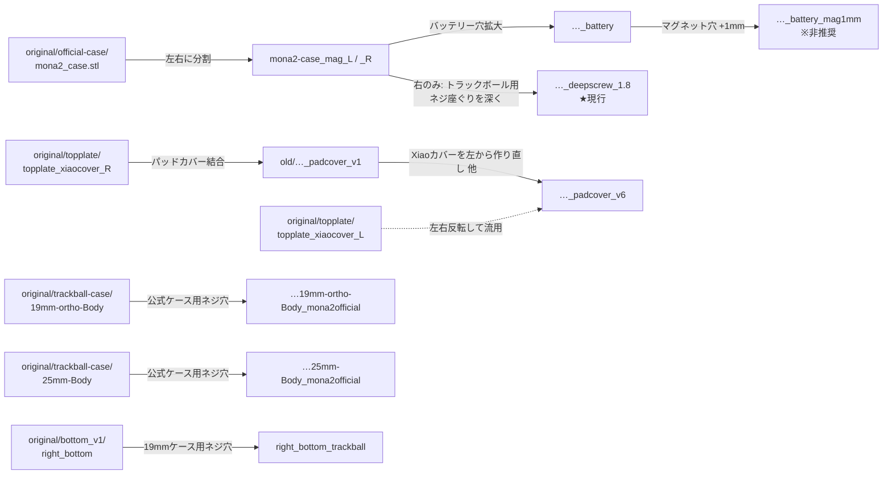
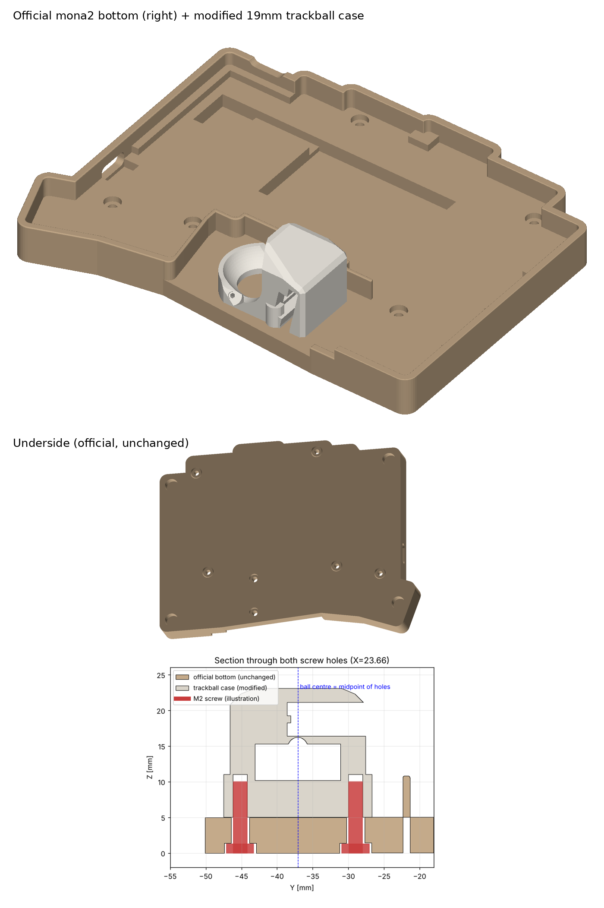
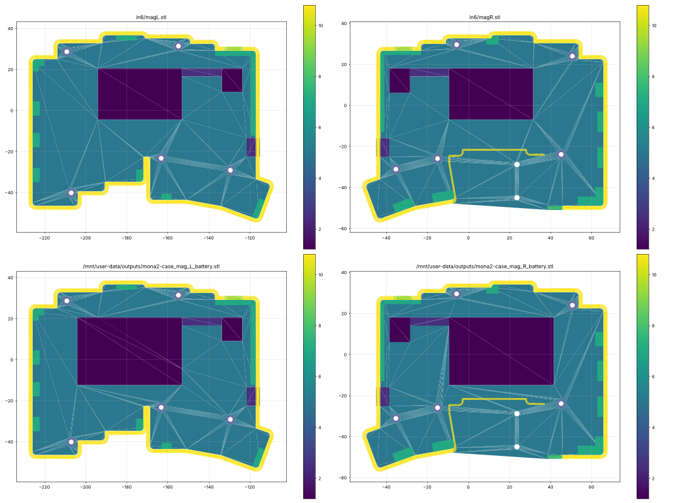
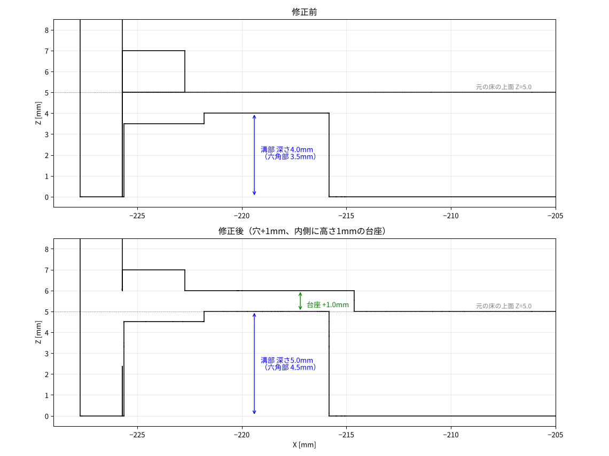
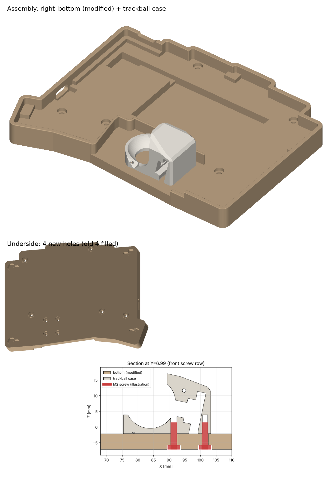

# model — moNa2（右手トラックボール版）の3Dモデル

moNa2用のケース・プレート・トラックボールケースのSTL置き場。
**`original/` は配布元のまま（無加工）**、**`custom/` はそれを自分用に加工したもの**。
加工版のファイル名は「元ファイル名 + 加工内容のサフィックス」で付けている。

## フォルダ構成

```
model/
├── README.md                 … このファイル
├── original/                 … 配布元のまま。加工の元データ（印刷用ではなく保管用）
│   ├── official-case/        … moNa2公式マグネットケース（左右一体のSTL）
│   ├── bottom_v1/            … ボトムケース v1（左右）
│   ├── bottom_v2/            … ボトムケース v2（左右）
│   ├── topplate/             … トッププレート（Xiaoカバー付き、左右）
│   ├── padcover/             … パッドカバー単体（zip内のSTL）
│   └── trackball-case/       … トラックボールケース 19mm / 25mm
├── custom/                   … 加工済み。印刷するのはこっち
│   ├── bottom-case-official/ … 公式マグネットケースの加工版
│   ├── bottom-case-v1/       … bottom_v1 の加工版
│   ├── top-plate/            … 右トッププレートの加工版（old/ は旧版）
│   └── trackball-case/       … トラックボールケースの加工版
└── docs/                     … 加工内容の説明画像
```

## 今使っている組み合わせ（印刷するもの）

| 部品 | 左 | 右 |
| --- | --- | --- |
| ボトムケース | `custom/bottom-case-official/mona2-case_mag_L_deepscrew_1.8.stl`（公式と同一） | `custom/bottom-case-official/mona2-case_mag_R_deepscrew_1.8.stl` |
| トッププレート | `original/topplate/topplate_xiaocover_L.stl`（無加工） | `custom/top-plate/topplate_xiaocover_R_padcover_v6.stl` |
| トラックボールケース | — | `custom/trackball-case/trackball-case-25mm-Body_mona2official.stl`（19mm球なら `…19mm-ortho-Body_mona2official.stl`） |

ネジ・マグネット・バッテリー等の部品はリポジトリ直下の [README](../README.md#hardware-specifications) を参照。

## 派生関係



---

## original/ — 配布元データ（無加工）

| ファイル | 内容・出典 |
| --- | --- |
| `official-case/mona2_case.stl` | moNa2公式のマグネットケース。左右が1つのSTLに入っている。元のファイル名は `mona2_case .stl`（スペース入り）だったのを修正 |
| `bottom_v1/left_bottom.stl`, `right_bottom.stl` | ボトムケース v1。`custom/bottom-case-v1/right_bottom_trackball.stl` の元 |
| `bottom_v2/left_bottom.stl`, `right_bottom.stl` | ボトムケース v2。現在は未使用 |
| `topplate/topplate_xiaocover_L.stl`, `_R.stl` | Xiaoカバー付きトッププレート。左はそのまま印刷して使用 |
| `padcover/padcover_moNa2.zip` | パッドカバー単体（zip内は `パッドカバー.stl`）。右トッププレートへの結合に使用 |
| `trackball-case/trackball-case-19mm-ortho-Body.stl` | 19mmトラックボールケース。trabo-tsuki から流用 |
| `trackball-case/trackball-case-25mm-Body.stl` | 25mmトラックボールケース |

---

## custom/ — 加工済みデータ

### bottom-case-official/ — 公式マグネットケースの加工版

元: `original/official-case/mona2_case.stl`。
**現行は `_deepscrew_1.8`**（公式そのまま + 右のトラックボール用ネジ穴だけ加工）。
`_battery` / `_battery_mag1mm` 系は下記の問題があったため使っていない（記録として残している）。

| ファイル | 加工内容 |
| --- | --- |
| `mona2-case_mag_L.stl` / `_R.stl` | ① 左右一体のSTLを左右に分割しただけ。形状は無加工。座標は元STLのまま（原点は動かしていない） |
| `mona2-case_mag_L_battery.stl` / `_R_battery.stl` | ② ①のバッテリー収納穴を **51 × 33 mm** に拡大（bottom_v1/v2 と同じサイズ）。303048バッテリーが入るように |
| `mona2-case_mag_L_battery_mag1mm.stl` / `_R_battery_mag1mm.stl` | ③ ②のマグネット穴を **1mm深く**（ダイソーのマグネットに合わせた）。穴を掘り下げた分、内側（床の上面）に高さ1mmの台座を足して床が抜けないようにしている。**非推奨**: この台座（Z=5〜6）が右ケース左下では親指キーの真下に来て、基板裏のソケットに当たり基板が浮いた（`docs/thumb_lift_investigation.png`） |
| `mona2-case_mag_R_deepscrew_1.8.stl` | **現行（右）**。①（公式そのまま）から、トラックボール固定用ネジ穴2か所の座ぐりだけを **深さ1.4mm → 3.2mm** に変更（ネジ頭を受ける底の残り厚 **1.8mm**）。ネジがトラックボールケース側に深く入り、よく噛むようにするため。マグネット穴・バッテリー穴は公式のまま |
| `mona2-case_mag_L_deepscrew_1.8.stl` | **現行（左）**。左にはトラックボール用ネジ穴がないので **①と同一データ**。右とファイル名を揃えるために置いている |

右ケースのトラックボール固定用ネジ穴（2か所）:
- 中心 X=23.66, Y=−45.18 と X=23.66, Y=−29.00（ピッチ16.18mm、元STLの座標）
- 床の厚み 5.0mm、ネジ軸の穴 Ø2.6、底面側にネジ頭用の座ぐり Ø4.5
- 座ぐりの深さ: 公式 1.4mm（残り3.6mm）→ `_deepscrew_1.8` では 3.2mm（残り1.8mm）。1.2mm / 2.4mm 残しも試作したが、強度とネジの噛みのバランスで1.8mmを採用







### bottom-case-v1/ — bottom_v1 の加工版

| ファイル | 加工内容 |
| --- | --- |
| `right_bottom_trackball.stl` | 元: `original/bottom_v1/right_bottom.stl`。トラックボールケース固定用の元の4穴を埋め、**19mmケース（`original/trackball-case/…19mm-ortho-Body.stl`、無加工）に合う位置**に4穴を開け直した |



### top-plate/ — 右トッププレートの加工版

| ファイル | 加工内容 |
| --- | --- |
| `topplate_xiaocover_R_padcover_v6.stl` | **最新版**。v1 の内容に加えて:<br>・Xiaoカバー部分が薄くて割れるため、**左プレートのXiaoカバーを左右反転して移植**（厚みを左と同じに）<br>・USB脚まわりに残っていた切り欠きを修正<br>・リセットボタン押し用の突起（半径0.65mm、中心 X=11.9, Y=78.77、Z=1.3〜1.8）を左と同じ形で作り直し |
| `old/topplate_xiaocover_R_padcover_v1.stl` | 旧版。元: `original/topplate/topplate_xiaocover_R.stl`。トラックボールとキーの間の隙間に**パッドカバー**（`original/padcover/`）を結合しただけ。それ以外は無加工 |

印刷メモ（Bambu Lab A1 mini）: リセット突起はとても細いので、積層ピッチを細かめ（0.12mm程度）にする。サポートは「ビルドプレートのみ」で、付きすぎる場合は「トップ面とのZ間隔」を広げる。


### trackball-case/ — トラックボールケースの加工版

公式マグネットケース（`custom/bottom-case-official/`）の右側には、トラックボールケース固定用のネジ穴が2つ（ピッチ16.18mm）しかない。
そこで、**ボトムケース側は無加工のまま、トラックボールケース側にその2穴に合うネジ穴を追加**した。ボールの中心が2穴の中点に来る位置にしている。

| ファイル | 元ファイル | 加工内容 |
| --- | --- | --- |
| `trackball-case-19mm-ortho-Body_mona2official.stl` | `original/trackball-case/trackball-case-19mm-ortho-Body.stl` | 公式ケースの2穴に合うM2ネジ穴を追加 |
| `trackball-case-25mm-Body_mona2official.stl` | `original/trackball-case/trackball-case-25mm-Body.stl` | 同上（25mm球用） |

---

## 変更履歴メモ

- 2026-08: 25mmトラックボールケース、bottom_v1/v2、トッププレートを追加
- 2026-10-19: 右トッププレートにパッドカバーを結合（v1）、19mmケースを流用、bottom_v1右のネジ穴を19mmケースに合わせて調整
- 2026-10-20: 公式ケースを追加。19mm/25mmトラックボールケースに公式ケース用ネジ穴を追加
- 2026-10-22: 公式ケースを左右に分割
- 2026-10-31: バッテリー穴拡大版、マグネット穴+1mm版、右トッププレート v6 を追加
- 2026-11: 右ケースのトラックボール用ネジ座ぐりを深くした `_deepscrew_1.8` を追加し、現行に。mag1mm版は基板が浮くため非推奨に
- 2026-11: model フォルダを `original/`（無加工）と `custom/`（加工版）に整理。直下にあった `topplate_xiaocover_L.stl` は `original/topplate/` と同一ファイルだったため削除
