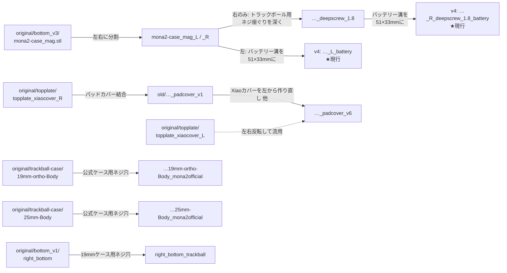
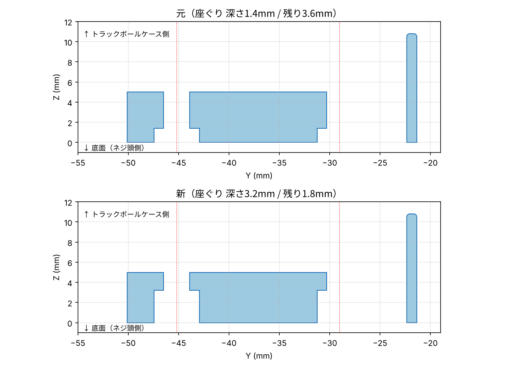
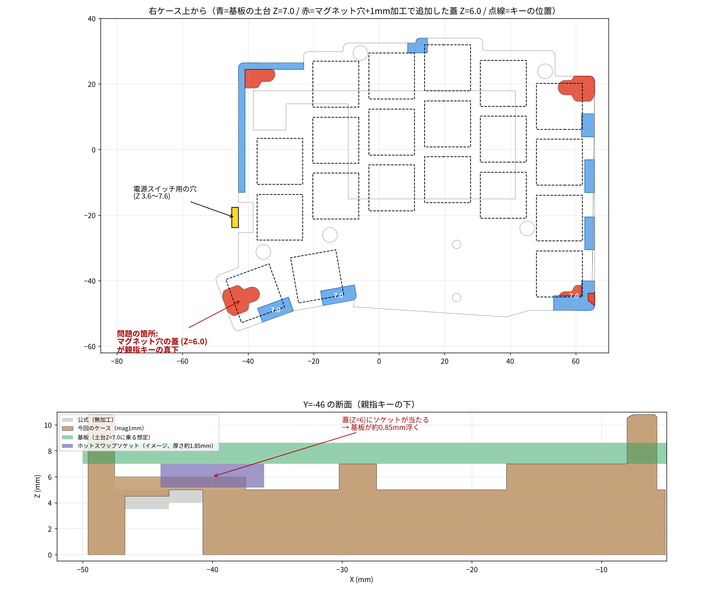
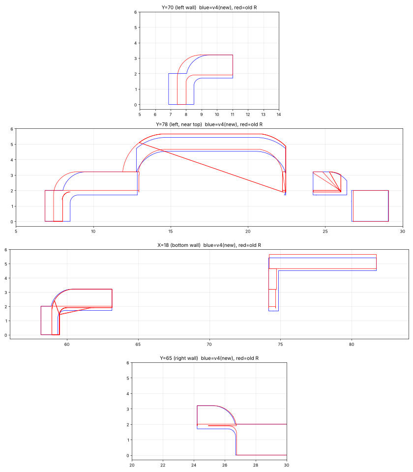

# model — moNa2（右手トラックボール版）の3Dモデル

moNa2用のケース・プレート・トラックボールケースのSTL置き場。
**`original/` は配布元のまま（無加工）**、**`custom/` はそれを自分用に加工したもの**。
加工版のファイル名は「元ファイル名 + 加工内容のサフィックス」で付けている。

## フォルダ構成

```
model/
├── README.md                 … このファイル
├── original/                 … 配布元のまま。加工の元データ（印刷用ではなく保管用）
│   ├── official-case/        … moNa2公式マグネットケース（左右一体のSTL）
│   ├── bottom_v1/            … ボトムケース v1（左右）
│   ├── bottom_v2/            … ボトムケース v2（左右）
│   ├── bottom_v3/            … マグネットケース（左右一体の元STLと、左右に分割したもの）
│   ├── topplate/             … トッププレート（Xiaoカバー付き、左右）
│   ├── padcover/             … パッドカバー単体（zip内のSTL）
│   └── trackball-case/       … トラックボールケース 19mm / 25mm
├── custom/                   … 加工済み。印刷するのはこっち
│   ├── bottom-case-v4/       … bottom-case-v3 のバッテリー溝を bottom_v2 と同じ大きさにした版（★現行のボトムケース）
│   ├── bottom-case-v3/       … bottom_v3 の加工版
│   ├── bottom-case-official/ … bottom_v3 の加工版の旧置き場（残りは重複データ）
│   ├── bottom-case-v1/       … bottom_v1 の加工版
│   ├── top-plate/            … 右トッププレートの加工版（old/ は旧版）
│   └── trackball-case/       … トラックボールケースの加工版
└── docs/                     … 加工内容の説明画像
```

## 今使っている組み合わせ（印刷するもの）

| 部品 | 左 | 右 |
| --- | --- | --- |
| ボトムケース | `custom/bottom-case-v4/mona2-case_mag_L_battery.stl` | `custom/bottom-case-v4/mona2-case_mag_R_deepscrew_1.8_battery.stl` |
| トッププレート | `original/topplate/topplate_xiaocover_L.stl`（無加工） | `custom/top-plate/topplate_xiaocover_R_padcover_v6.stl` |
| トラックボールケース | — | `custom/trackball-case/trackball-case-25mm-Body_mona2official.stl`（19mm球なら `…19mm-ortho-Body_mona2official.stl`） |

ネジ・マグネット・バッテリー等の部品はリポジトリ直下の [README](../README.md#hardware-specifications) を参照。

## 派生関係



---

## original/ — 配布元データ（無加工）

| ファイル | 内容・出典 |
| --- | --- |
| `official-case/mona2_case.stl` | moNa2公式のマグネットケース。出典: [sayu:works（STORES）](https://sayuworks.stores.jp/)。左右が1つのSTLに入っている。元のファイル名は `mona2_case .stl`（スペース入り）だったのを修正 |
| `bottom_v1/left_bottom.stl`, `right_bottom.stl` | ボトムケース v1。出典: [sayu-hub/zmk-config-moNa2](https://github.com/sayu-hub/zmk-config-moNa2)。`custom/bottom-case-v1/right_bottom_trackball.stl` の元 |
| `bottom_v2/left_bottom.stl`, `right_bottom.stl` | ボトムケース v2。出典: [sayu-hub/zmk-config-moNa2](https://github.com/sayu-hub/zmk-config-moNa2)。現在は未使用 |
| `bottom_v3/mona2-case_mag.stl` | マグネットケース（左右一体）。出典: [dgarai/zmk-config-moNa2 の `model/case/mona2-case_mag.stl`](https://github.com/dgarai/zmk-config-moNa2/blob/main/model/case/mona2-case_mag.stl)。`official-case/mona2_case.stl` とはマグネット穴の形が違う（下記） |
| `bottom_v3/mona2-case_mag_L.stl`, `_R.stl` | 上の左右一体STLを左右に分割しただけ。形状・座標は元のまま。`custom/bottom-case-v3/` の加工元 |
| `topplate/topplate_xiaocover_L.stl`, `_R.stl` | Xiaoカバー付きトッププレート。出典: [sayu:works（STORES）](https://sayuworks.stores.jp/items/692d55656e431238dccf8fb7)、[sayu-hub/zmk-config-moNa2](https://github.com/sayu-hub/zmk-config-moNa2)。左はそのまま印刷して使用 |
| `padcover/padcover_moNa2.zip` | パッドカバー単体（zip内は `パッドカバー.stl`）。出典: [sayu:works（STORES）](https://sayuworks.stores.jp/)。右トッププレートへの結合に使用 |
| `trackball-case/trackball-case-19mm-ortho-Body.stl` | 19mmトラックボールケース。torabo-tsuki から流用。出典: [sekigon-gonnoc/torabo-tsuki-lp](https://github.com/sekigon-gonnoc/torabo-tsuki-lp/tree/master/3d-models/STL) |
| `trackball-case/trackball-case-25mm-Body.stl` | 25mmトラックボールケース。出典: [sekigon-gonnoc/torabo-tsuki-lp](https://github.com/sekigon-gonnoc/torabo-tsuki-lp/tree/master/3d-models/STL) |

---

## custom/ — 加工済みデータ

### bottom-case-v4/ — バッテリー溝を広げた版（★現行）

`custom/bottom-case-v3/` の2ファイルはバッテリー溝が 41 × 25 mm で、バッテリーが入らなかった。
そこで、`original/bottom_v2/`（ぴったり入ることを確認済み）と同じ **51 × 33 mm** に広げた。深さは同じ（溝の底 Z=1.2、床の上面 Z=5.0）。

| ファイル | 元ファイル | 加工内容 |
| --- | --- | --- |
| `mona2-case_mag_L_battery.stl` | `bottom-case-v3/mona2-case_mag_L.stl` | バッテリー溝を X−側に10mm、Y−側に8mm広げた（X −204〜−153、Y −12.61〜20.39） |
| `mona2-case_mag_R_deepscrew_1.8_battery.stl` | `bottom-case-v3/mona2-case_mag_R_deepscrew_1.8.stl` | バッテリー溝を X+側に10mm、Y−側に8mm広げた（X −9.41〜41.59、Y −15.11〜17.89）。トラックボール用ネジ座ぐり（1.8mm残し）はそのまま |

溝の位置と大きさは、bottom_v2 を平行移動で bottom_v3 の座標に重ねて合わせた（左: (−170.73, −5.72, +7.92)、右: (+9.92, −8.70, +7.61)。外形が一致する）。
ブーリアン演算は使わず、溝の壁の頂点を外側へ動かした（トポロジーは変わらない）。

確認したこと:
- 外形の大きさ（バウンディングボックス）は加工前と同じ
- 動いた頂点はすべて新しい溝の範囲内（Z 1.2〜5.0）。それ以外の面は加工前と完全に一致
- 床の上面の面積は −658mm²、溝の底の面積は +658mm²（= 51×33 − 41×25）。底面と天面は変化なし
- 体積の減少は 2500.4mm³（= 658 × 3.8）で理論値と一致。向きが反転した面はない

### bottom-case-v3/ と bottom-case-official/ — bottom_v3（マグネットケース）の加工版

元: `original/bottom_v3/mona2-case_mag.stl`（左右分割したものは `original/bottom_v3/mona2-case_mag_{L,R}.stl`）。
`bottom_v3` そのまま + 右のトラックボール用ネジ穴だけ加工したもの（`bottom-case-v4/` の元）。

※ 以前のREADMEでは、このフォルダの元を `original/official-case/mona2_case.stl` と書いていた。実際に形状を比べると、`mona2-case_mag_L/_R.stl` は bottom_v3 を分割したものと面単位で一致し、official-case とは一致しない。違いはマグネット穴で、official-case は Ø6 の丸穴（深さ3.5mm）、bottom_v3 は約9.8×5.9mm の差し込み口の奥に 6×2mm の穴がある形（深さ4.0mm）。
以前は、バッテリー穴拡大版（`_battery`）と、さらにマグネット穴を+1mmした版（`_battery_mag1mm`）があった。mag1mm版は基板が浮く問題（下記の調査図）があり、どちらも使わなくなったので削除した。

現行は `bottom-case-v4/`（上記）。以下の `bottom-case-v3/` の2ファイルはバッテリー溝が小さい（41 × 25 mm）。

| ファイル | 加工内容 |
| --- | --- |
| `bottom-case-v3/mona2-case_mag_L.stl` | 左。bottom_v3 の左右一体のSTLを分割した左側。形状は無加工、座標は元STLのまま（`original/bottom_v3/mona2-case_mag_L.stl` と同一） |
| `bottom-case-v3/mona2-case_mag_R_deepscrew_1.8.stl` | 右。bottom_v3 の右側から、トラックボール固定用ネジ穴2か所の座ぐりだけを **深さ1.4mm → 3.2mm** に変更（ネジ頭を受ける底の残り厚 **1.8mm**）。ネジがトラックボールケース側に深く入り、よく噛むようにするため。マグネット穴・バッテリー穴は元のまま |
| `bottom-case-official/mona2-case_mag_R.stl` | bottom_v3 の右側を分割しただけ（`original/bottom_v3/mona2-case_mag_R.stl` と同一） |
| `bottom-case-official/mona2-case_mag_L_deepscrew_1.8.stl` | 左にはトラックボール用ネジ穴がないので、`bottom-case-v3/mona2-case_mag_L.stl` と同一データ |

右ケースのトラックボール固定用ネジ穴（2か所）:
- 中心 X=23.66, Y=−45.18 と X=23.66, Y=−29.00（ピッチ16.18mm、元STLの座標）
- 床の厚み 5.0mm、ネジ軸の穴 Ø2.6、底面側にネジ頭用の座ぐり Ø4.5
- 座ぐりの深さ: 公式 1.4mm（残り3.6mm）→ `_deepscrew_1.8` では 3.2mm（残り1.8mm）。1.2mm / 2.4mm 残しも試作したが、強度とネジの噛みのバランスで1.8mmを採用





mag1mm版は、マグネット穴を1mm深くし、その分床の上（Z=5〜6）に台座を足していた。この台座が右ケース左下で親指キーの真下に来て、基板裏のソケットに当たり、基板が約0.85mm浮いた。

### bottom-case-v1/ — bottom_v1 の加工版

| ファイル | 加工内容 |
| --- | --- |
| `right_bottom_trackball.stl` | 元: `original/bottom_v1/right_bottom.stl`。トラックボールケース固定用の元の4穴を埋め、**19mmケース（`original/trackball-case/…19mm-ortho-Body.stl`、無加工）に合う位置**に4穴を開け直した |


### top-plate/ — 右トッププレートの加工版

| ファイル | 加工内容 |
| --- | --- |
| `topplate_xiaocover_R_padcover_v6.stl` | **最新版**。v1 の内容に加えて:<br>・Xiaoカバー部分が薄くて割れるため、**左プレートのXiaoカバーを左右反転して移植**（厚みを左と同じに）<br>・USB脚まわりに残っていた切り欠きを修正<br>・リセットボタン押し用の突起（半径0.65mm、中心 X=11.9, Y=78.77、Z=1.3〜1.8）を左と同じ形で作り直し |
| `old/topplate_xiaocover_R_padcover_v1.stl` | 旧版。元: `original/topplate/topplate_xiaocover_R.stl`。トラックボールとキーの間の隙間に**パッドカバー**（`original/padcover/`）を結合しただけ。それ以外は無加工 |

印刷メモ（Bambu Lab A1 mini）: リセット突起はとても細いので、積層ピッチを細かめ（0.12mm程度）にする。サポートは「ビルドプレートのみ」で、付きすぎる場合は「トップ面とのZ間隔」を広げる。



### trackball-case/ — トラックボールケースの加工版

マグネットケース（`custom/bottom-case-v3/`）の右側には、トラックボールケース固定用のネジ穴が2つ（ピッチ16.18mm）しかない。
そこで、**ボトムケース側は無加工のまま、トラックボールケース側にその2穴に合うネジ穴を追加**した。ボールの中心が2穴の中点に来る位置にしている。

| ファイル | 元ファイル | 加工内容 |
| --- | --- | --- |
| `trackball-case-19mm-ortho-Body_mona2official.stl` | `original/trackball-case/trackball-case-19mm-ortho-Body.stl` | 公式ケースの2穴に合うM2ネジ穴を追加 |
| `trackball-case-25mm-Body_mona2official.stl` | `original/trackball-case/trackball-case-25mm-Body.stl` | 同上（25mm球用） |

---

## 変更履歴メモ

- 2026-08: 25mmトラックボールケース、bottom_v1/v2、トッププレートを追加
- 2026-10-19: 右トッププレートにパッドカバーを結合（v1）、19mmケースを流用、bottom_v1右のネジ穴を19mmケースに合わせて調整
- 2026-10-20: 公式ケースを追加。19mm/25mmトラックボールケースに公式ケース用ネジ穴を追加
- 2026-10-22: 公式ケースを左右に分割
- 2026-10-31: バッテリー穴拡大版、マグネット穴+1mm版、右トッププレート v6 を追加
- 2026-11: 右ケースのトラックボール用ネジ座ぐりを深くした `_deepscrew_1.8` を追加し、現行に。mag1mm版は基板が浮くため非推奨に
- 2026-11: model フォルダを `original/`（無加工）と `custom/`（加工版）に整理。直下にあった `topplate_xiaocover_L.stl` は `original/topplate/` と同一ファイルだったため削除
- 2026-11: 使っていなかった `_battery` / `_battery_mag1mm` 系（左右4ファイル）と、その説明画像を削除
- 2026-11-16: `original/bottom_v3/` を追加（マグネットケースの元STLと左右分割版）。`custom/bottom-case-official/` の元が official-case ではなく bottom_v3 だったことが分かったので、READMEの派生関係を修正
- 2026-11-16: 現行の左右ケース（`mona2-case_mag_L.stl`、`mona2-case_mag_R_deepscrew_1.8.stl`）を `custom/bottom-case-v3/` に移動
- 2026-11-16: バッテリーが入らなかったため、バッテリー溝を bottom_v2 と同じ 51 × 33 mm に広げた `custom/bottom-case-v4/` を追加し、現行に
